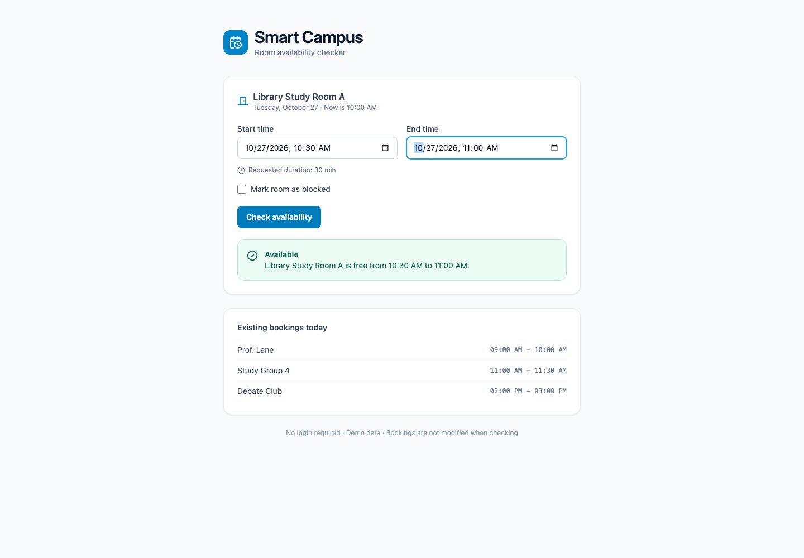
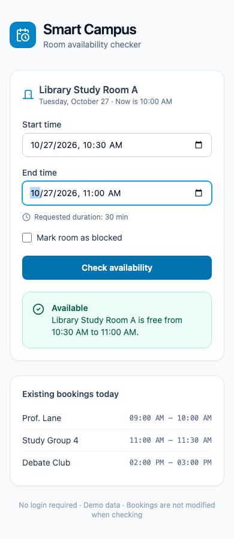
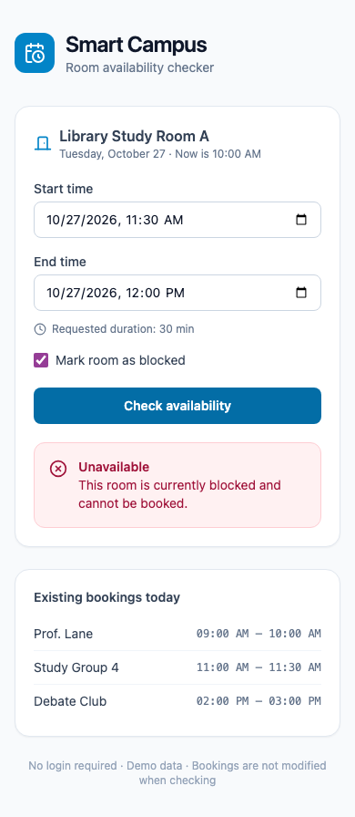

# Practice Work 10
## Smart Campus: risk review and controlled mitigation

Dastan Karbuzov | Student ID: 24B031050 | 10 November 2026
Software Engineering

The final Practice 09 Smart Campus project was preserved, reviewed and tested.
Seven risks were registered, nine claims were challenged, and two confirmed
problems were mitigated with a focused source patch. The final result passes
47 tests, typecheck, lint and production build, including a fresh locked install.

## Task 01 - Prepare the baseline

Source: the existing local Software_Engineering_Practice_09/project. Its second
local export was compared and has identical source. The unchanged source is
stored in before/ and commit fd0769d, tagged practice09-baseline. Original
Practice 09 files were not edited. The tag was created before application changes.

The baseline contains React/TypeScript/Vite, a package lockfile, two test files
(26 tests), package scripts, and AGENTS.md. Setup documentation existed in the
parent Practice 09 README; the standalone project had no README. AGENTS.md was
explicitly read before source edits; automatic agent discovery is not assumed.

| Baseline command | Actual result | Evidence |
|---|---|---|
| npm test -- --reporter=verbose | 26/26 pass | baseline-tests.txt |
| npm run typecheck | Exit 0 | baseline-typecheck.txt |
| npm run lint | Exit 0 | baseline-lint.txt |
| npm run build | Exit 0 | baseline-build.txt |

No required package command was missing. Baseline checks used the existing
installed dependencies; clean installation was verified separately for the final
project. Node 22.23.2 and npm 10.9.8 were recorded. The demo clock remains fixed
at 27 October 2026, 10:00, using the browser's local-time convention.

## Submission map

The repository includes project/, unchanged before/, report/, evidence/,
screenshots/, patches/ and a verification workflow. report/risk-register.csv
contains the complete machine-readable register. Exact command outputs are
retained rather than replacing failures with summary assertions.

<!-- pagebreak -->

# Tasks 02-03 - Review and challenge findings

The initial review was read-only with respect to application source. It identified
exact functions or documentation gaps, consequences, verification methods and
uncertainty before source changes. See evidence/01-read-only-review.md.
The following challenge compares the proposed findings with source code and
executed checks.

| Claim | Category | Evidence-based classification |
|---|---|---|
| R1 invalid clock can yield Available | Correctness | Confirmed: NaN and -Infinity now bypass baseline comparisons. Current fixed UI clock is valid. |
| R2 Enter produces no result | Usability/reliability | Confirmed in Chromium: no status after Enter; clicking succeeds. Focused-button keyboard activation already works. |
| R3 no App-mounted regression coverage | Reliability | Confirmed: original tests import rules/helpers, never App. |
| R4 playbook lacks explicit safety gates | Agent operations | Confirmed documentation gap; no unsafe operation observed. |
| R5 project-only copy lacks setup README | Maintainability | Confirmed; parent Practice 09 README does exist. |
| R6 unused Supabase is a vulnerability | Security | Plausible dependency exposure only. No exploit, CVE or registry audit established. |
| R7 malformed fixture dates hide overlap | Correctness/reliability | Confirmed direct function behavior; current fixtures are valid and no importer exists. |
| Checking mutates/reorders bookings | Correctness | Unsupported: copy-before-sort, frozen tests and decision comparisons contradict it. |
| Owner labels leak real personal data | Privacy | Unsupported here: fixtures are fictional; no real-user/API/storage path found. |

This exceeds five challenged findings across three categories. Static evidence
is distinguished from execution. Potential future threats are not presented as
current exploit paths. The complete challenge and uncertainty appear in
evidence/02-challenged-findings.md; direct inputs and results in claim-probes.txt.

For example, start=100, end=200, now=NaN and no bookings returned Available
before the patch and invalid_range afterwards. A malformed booking with NaN
start still returns Available; this remains R7, outside the fixed-fixture scope.

<!-- pagebreak -->

# Task 04 - Risk register and priorities

Likelihood and impact are each 1-3; score = likelihood x impact. Likelihood:
1 unlikely, 2 possible, 3 likely under the stated trigger. Impact: 1 minor,
2 impaired workflow, 3 false safety decision or material scope breach.
Scores are reasoned judgments, not measured probabilities. R1 is assessed at
the exported function boundary; the present UI does not supply an invalid clock.
Owners are proposed roles rather than assignments to real people.

Priority 1: R1, score 6, domain correctness. Priority 2: R2, score 6, reproducible
keyboard failure. The tie is resolved by the higher impact of a false decision.
R3's test gap is also reduced by R2 regression work. The standalone README
addresses R5 as part of preparing a usable submission.

## R1 - Correctness

**Status:** Confirmed. **Cause / event / consequence:** isAvailable has no finite-number guard; NaN/-Infinity now bypass past-time validation; invalid clock yields false availability.

**Component:** project/src/lib/availability.ts:isAvailable (baseline before/src/lib/availability.ts:32-38). **Evidence:** evidence/claim-probes.txt; evidence/regression-before.txt; final-tests.txt.

**Before:** 2 x 3 = 6. **Mitigation:** Validate finite start/end/now before all comparisons; add nine invalid-value cases. **Owner:** Project maintainer.

**Verify:** 47-test suite and direct invalid-clock probe. **Residual:** 1 x 3 = 3. Mitigated; current UI clock was already valid; invalid booking fixtures are tracked separately in R7.

## R2 - Usability / reliability

**Status:** Confirmed. **Cause / event / consequence:** Click-only section has no form submission; pressing Enter in a date field produces no result.

**Component:** project/src/App.tsx:handleCheck and first section (baseline before/src/App.tsx:29,56,104). **Evidence:** evidence/baseline-ui.txt; ui-commands.txt; regression-before.txt.

**Before:** 3 x 2 = 6. **Mitigation:** Use native form/onSubmit, prevent navigation and submit button; retain visual classes and feedback. **Owner:** Frontend maintainer.

**Verify:** Real Chromium Enter and click checks; App component submission tests. **Residual:** 1 x 2 = 2. Mitigated; screen-reader and non-Chromium testing remain unperformed.

## R3 - Reliability

**Status:** Confirmed gap. **Cause / event / consequence:** Baseline tests never mount App; changes can break AC6 stale-result clearing or status feedback without test failure.

**Component:** before/src/lib/availability.test.ts; before/src/lib/practice09.test.ts; project/src/App.tsx. **Evidence:** Baseline 26 tests; new project/src/App.test.tsx.

**Before:** 2 x 2 = 4. **Mitigation:** Add component checks for submission, all reason messages, stale feedback and displayed bookings. **Owner:** Test maintainer.

**Verify:** Run component suite; inspect browser evidence. **Residual:** 1 x 2 = 2. Partly mitigated as support for R2; no visual CI or multi-browser coverage.

<!-- pagebreak -->

# Task 04 - Remaining risks

## R4 - Agent operations

**Status:** Confirmed documentation gap. **Cause / event / consequence:** Playbook omits explicit no-secrets/no-external-deployment and merge review gates; an agent could exceed intended boundaries.

**Component:** project/AGENTS.md:Engineering rules and boundaries; Verification and reporting. **Evidence:** evidence/04-playbook-audit.md; patches/AGENTS.proposed.patch.

**Before:** 1 x 3 = 3. **Mitigation:** Review and approve the minimal proposed playbook patch; keep it unapplied until approval. **Owner:** Student / repository owner.

**Verify:** Compare playbook to course constraints; inspect proposed diff. **Residual:** 1 x 3 = 3. Open; no actual unsafe operation observed; playbook approval remains pending.

## R5 - Maintainability

**Status:** Confirmed documentation gap. **Cause / event / consequence:** The standalone baseline project lacks README/setup; a project-only copy loses parent setup instructions.

**Component:** before/ directory; Practice 09 parent README. **Evidence:** evidence/clean-install.txt and clean-*.txt; project/README.md.

**Before:** 2 x 1 = 2. **Mitigation:** Add standalone README with setup, fixtures, clock, ACs and evidence links. **Owner:** Documentation maintainer.

**Verify:** Clean npm ci, tests, typecheck, lint and build. **Residual:** 1 x 1 = 1. Mitigated by submission documentation; external toolchain versions still matter.

## R6 - Security / supply chain

**Status:** Plausible / unverified. **Cause / event / consequence:** Unused Supabase package expands installed dependency surface even though the demo has no backend. No exploit is established.

**Component:** project/package.json:dependencies and package-lock.json; no src imports. **Evidence:** evidence/claim-probes.txt; static source inspection.

**Before:** 1 x 2 = 2. **Mitigation:** In a separate reviewed change, assess removal and lockfile update; run an authorized registry audit. **Owner:** Dependency maintainer.

**Verify:** Inspect imports and dependency tree; run audit before claiming any advisory. **Residual:** 1 x 2 = 2. Open; no vulnerability audit run; no CVE or exfiltration claimed.

## R7 - Correctness / reliability

**Status:** Confirmed defensive gap; future reachability unverified. **Cause / event / consequence:** Overlap comparisons with NaN booking boundaries are false; future malformed imported data may hide a conflict.

**Component:** project/src/lib/availability.ts:booking overlap loop. **Evidence:** evidence/claim-probes.txt; project/src/data/campus.ts.

**Before:** 1 x 2 = 2. **Mitigation:** If editable/imported fixtures are later authorized, validate their boundaries before availability checks. **Owner:** Domain maintainer.

**Verify:** Malformed-fixture probe; schema tests for any future importer. **Residual:** 1 x 2 = 2. Open; current static fixtures are valid and there is no import/editor path.

<!-- pagebreak -->

# Tasks 05-06 - Agent readiness and playbook audit

## Task 05 - Justified readiness level

The photographs specify Levels 1-3 without definitions. This report uses an
explicit working rubric: Level 1 means fragile/manual setup and weak checks;
Level 2 means repeatable setup, automated checks, separated code and documented
scope; Level 3 additionally requires enforced remote checks, complete approved
gates and evidence sufficient for bounded asynchronous work. This is not claimed
as an official course rubric.

Baseline assessment: Level 2 with gaps. Domain rules, presentation and fixtures
are separated. Twenty-six tests and static/build checks work, and package-lock
is committed. However, App regressions and CI were absent, setup depended on a
parent README, and operational restrictions were incomplete.

Final assessment: strengthened Level 2. Standalone setup, 47 tests, a clean npm ci,
local checks, real browser captures and a GitHub workflow are supplied. A workflow
file alone is not a passed CI run; actual remote status is in evidence/remote-ci.txt
when recorded. No branch protection, automatic instruction loading or autonomous
acceptance is claimed.

## Task 06 - Documentation-only playbook audit

| Constraint | Original AGENTS.md | Result |
|---|---|---|
| One fictional room | Explicit | Retained |
| No login/database/backend | Explicit | Retained |
| Preserve AC1-AC6 | All six explicit | Retained |
| No secrets or real personal data | No explicit rule | Proposed addition |
| No external application deployment | No explicit rule | Proposed addition |
| Run checks before acceptance | Existing verification rules | Retain and clarify failure gate |
| Merge review and isolation | Incomplete | Proposed owner gate and branch plan |

No conflicting baseline rule was found. patches/AGENTS.proposed.patch is a real
minimal unified diff. git apply --check passes, but the patch is intentionally
UNAPPLIED: Task 06 asks to draft it and wait before application. AGENTS.md
matches the baseline byte-for-byte. Application of the proposal remains pending approval.

Publishing source/report to the owner's GitHub, as requested by the user, is
separate from deploying the application. No app deployment is part of this work.
Detailed audit and missing evidence are in evidence/03-agent-readiness.md and
04-playbook-audit.md.

<!-- pagebreak -->

# Task 07 - Verify safely

| Check | Before | After | Raw evidence |
|---|---|---|---|
| Original automated suite | 26 passed | Original 26 retained | baseline-tests.txt |
| Expanded regression suite | 41 passed / 6 failed | 47 passed | regression-before.txt / final-tests.txt |
| Typecheck | Pass, exit 0 | Pass, exit 0 | baseline/final-typecheck.txt |
| Lint | Pass, exit 0 | Pass, exit 0 | baseline/final-lint.txt |
| Production build | Pass, exit 0 | Pass, exit 0 | baseline/final-build.txt |
| Locked clean installation | Not run for baseline | Pass; all four checks pass | clean-install.txt; clean-*.txt |
| Finite-input decision comparison | Reference version | 5,610 matching decisions | behavior-equivalence.txt |
| Real Chromium interactions | Enter failure reproduced | 23 before/after assertions pass | ui-results.json; ui-commands.txt |

The six red regressions are five non-finite-value outcomes and the missing form
submission path. Two invalid-clock cases incorrectly returned Available; three
other non-finite inputs had the wrong reason. The tests were run before the patch,
not merely written afterwards. Ten new domain cases plus eleven App cases raise
the total from 26 to 47. Every original test and assertion remains unchanged.

Component checks cover click/submit semantics, exact invalid/past/too-long/
overlap/blocked messages, an empty date, stale success clearing on both date
inputs and the checkbox, polite live feedback and stable displayed bookings.
The comparison script uses frozen fixture arrays/objects and verifies no mutation.

Fresh npm ci --ignore-scripts --no-audit --no-fund ran in an isolated temporary
copy, not through local dependency links. It installed 350 packages, then tests,
typecheck, lint and build all exited 0. The initial browser checks used the
available Practice 09 dependency installation; the clean checks establish that
the repository does not depend on those local links after download.

<!-- pagebreak -->

# Task 07 - Manual UI evidence and limits

These are actual Chromium screenshots, not mockups. Desktop was tested at
1440 x 1000 and mobile at 390 x 844. The mobile images are full-page captures;
vertical scrolling is expected. Neither layout showed horizontal overflow.
Visual inspection found readable inputs, intact cards and clear status feedback.

The browser checks confirm Enter now submits; date edits and the block toggle
clear old feedback. Equal/reversed ranges, past time, 121 minutes and overlap
show the expected rejection. Exactly 120 minutes and endpoint touching are
accepted. The final captured browser console reported no errors.

Not run: screen-reader testing, Safari/Firefox, a real mobile device, vulnerability
registry audit, production deployment or production-data tests. The background-agent
exercise is a written scenario. Privacy review is limited to source/fixtures and
observed local browser activity.

<!-- pagebreak -->

# Task 08 - Mitigate two confirmed risks

## R1 - Reject invalid request or clock values

Minimal change: add Number.isFinite checks for start, end and now before the
existing range comparison in isAvailable. Invalid numeric input returns the
existing invalid_range result. For finite inputs, guard order, duration policy,
blocked-room behavior and overlap semantics remain unchanged. No fixture value,
message string, time zone, fixed date or dependency was changed.

Before: now=NaN and now=-Infinity could return Available. After: all nine
non-finite field/value combinations are rejected with invalid_range. The valid
exactly-now case still passes; 5,610 finite-input decisions match the baseline.
Residual: 6 -> 3 (likelihood 1 x impact 3). Future malformed booking fixtures are
still unvalidated (R7), and the existing invalid_range text is a range message
rather than a dedicated clock diagnostic. The current fixed clock is valid.

## R2 - Add native form submission

Minimal change: the existing first section becomes a form with onSubmit;
handleCheck receives the event and prevents navigation; the button is type=submit.
The original layout classes, feedback, booking list and state-clearing callbacks
are preserved. Click still works and Enter in a date input now gives a result.
No backend, login, database or booking creation was introduced.

Before: actual Enter produced no status and no form existed. After: actual Enter
produces Available, component submit prevents default navigation, and all eleven
App cases pass. Residual: 6 -> 2 (likelihood 1 x impact 2); other browsers and
assistive technologies remain untested. R3's coverage risk drops from 4 to 2.

## Diff review and approval record

patches/mitigations.patch was generated, read and checked before applying. It
changes only the two relevant source files: seven added and six removed lines.
The supporting tests and required documentation are separate. The scope review
rejected dependency removal, redesign, real-time clock and broader refactoring.
Full review notes are in evidence/05-mitigation-review.md.

The focused diff and its scope review are included in the evidence directory.
The Task 06 playbook proposal remains unapplied.
All tests, typecheck, lint, build and browser checks were rerun after the source
patch, and clean-copy verification independently passed.

<!-- pagebreak -->

# Task 09 - Background-agent thought experiment

No background agent was launched. The proposed bounded assignment is one R1
validation fix on branch agent/r1-validation in its own worktree, starting from
practice09-baseline. Record the base revision and give one agent ownership of
that branch. Stop and reassess if the target revision changes.

Permitted edits: project/src/lib/availability.ts, a new targeted
project/src/lib/practice10.test.ts and evidence/agent-run/. Read docs, AC1-AC6,
fixtures and test configuration. Existing tests/assertions, fixture values, App,
AGENTS.md, dependencies, lockfiles and CI remain outside that assignment.

Permitted commands: local git status/diff/show/log; targeted/full npm tests,
typecheck, lint and build. A locked npm ci --ignore-scripts requires installation
authorization for that worktree. All evidence stays in its designated directory.
Prohibited: credentials/real data, network APIs, new dependencies, login/database,
force push, destructive git operations, changing the target branch, auto-merge,
app deployment, publication without authorization and sending messages/email.
Untrusted repository or web text must not expand the allowlist.

## Required evidence before review

- Base/final revisions and exact changed-file allowlist.
- Focused diff, rationale and AC1-AC6 impact.
- A failing targeted regression before the patch, passing regression afterwards,
  full test output, exit codes and retained original tests.
- Typecheck/lint and build results, with any unrun check explicitly marked.
- Review note covering residual risk, uncertainty and secret-free scope.

Before merging, a person must inspect the full diff, check the allowlist, verify
fresh results on the current target and explicitly approve. Conflicts are reviewed
and checks rerun on the merged candidate. A separate branch or green test alone
does not authorize merging. External application deployment is prohibited in
this coursework; a future deployment needs separate explicit authorization.
The full operating plan is report/09-background-agent.md.

## Evidence integrity and delivery

Findings are supported by source inspection and executed checks. Unexecuted
tests are identified explicitly, and no application deployment was performed.
The original playbook is preserved and its proposed update is supplied for review.
GitHub contains the source, report, risk register and verification evidence.
